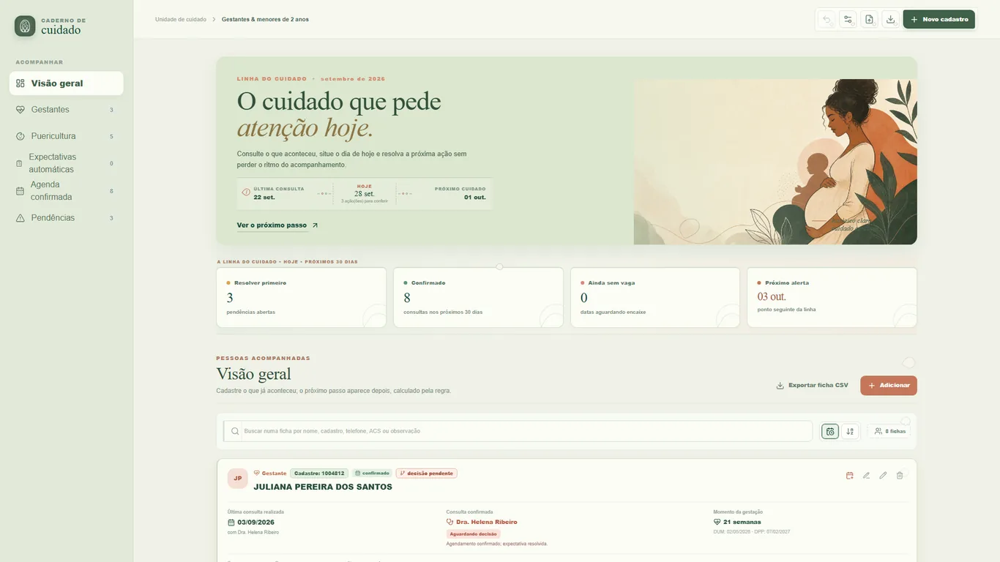

# Caderno de Cuidado

Agenda offline para equipes de atenção primária acompanharem gestantes e crianças de 0 a 2 anos. O aplicativo registra o que já aconteceu, calcula o próximo marco de cuidado pela regra de periodicidade e organiza faltas, encaixes, pendências, contatos e histórico em um só lugar. A decisão continua humana: o Caderno é apoio à organização, não prontuário, dispositivo médico ou protocolo de urgência.



## O que é

O Caderno de Cuidado foi pensado para o trabalho real da equipe: quem cadastra mantém a ficha e o contato atualizados; quem decide confere a data sugerida, a vaga e o profissional; quem acompanha vê o histórico, as faltas e o próximo passo. Funciona offline por padrão e pode ser instalado no Windows (MSIX pela Microsoft Store), no Android (AAB/Google Play) e no navegador como PWA.

- **Windows:** `1.25.15` — pacote MSIX `1.25.15.0`.
- **Web/PWA:** `1.25.15` — build em `docs/app/`.
- **Android:** `1.27.7` — versionCode `8` (vC8), em teste interno.

## Recursos principais

- Cadastro de gestantes com DUM, DPP, semanas de gestação, última consulta e profissional.
- Puericultura de 1 a 24 meses, com sequência de consultas e alternância entre medicina e enfermagem.
- Cálculo do próximo marco a partir da última consulta realizada; consulta realizada dentro de ±4 dias da data ideal confirma o marco.
- Um dia, um evento: realizada, falta e cancelamento são mutuamente exclusivos; o app bloqueia um segundo evento no mesmo dia.
- Falta e cancelamento não consomem o marco ideal: a expectativa continua aguardando encaixe.
- Agenda confirmada, expectativas automáticas, pendências de decisão, avisos e conferências.
- Exportação CSV/JSON, importação de backup e impressão da agenda/expectativas.
- Sincronização opcional entre Windows e Android pelo Google Drive, com merge por operação, tombstones, versões lógicas e conflitos visíveis para resolução.
- Layout responsivo: referência de 1366×768 no desktop e 390×844 no celular.

### Regra de agenda em resumo

A próxima data é o marco seguinte depois da última consulta realizada. Se a consulta realizada estiver a até 4 dias antes ou depois da data ideal, ela também cumpre o marco anterior. Distâncias maiores que 4 dias abrem uma decisão para a equipe; intervalos menores que 20 dias geram aviso. O app não altera a regra sozinho e não escolhe conduta.

## Privacidade e armazenamento

- **Offline por padrão.** Fichas, consultas, configurações e histórico ficam no armazenamento local do dispositivo/navegador. Sem login, nenhum dado sai do aparelho.
- **Sem servidor próprio.** Não há backend, anúncios, analytics ou rastreadores. O app não pede localização, câmera, microfone ou contatos.
- **Google Drive opcional.** Quando o usuário ativa a integração, o app usa o escopo `drive.appdata` e grava arquivos de backup na pasta oculta reservada a ele no **próprio** Drive do usuário. Cada dispositivo mantém um arquivo de operações (`caderno-ops-<deviceId>.json`); versões antigas com `caderno-backup.json` continuam legíveis para migração.
- **Conflitos preservados.** Exclusões usam tombstones (`del`); edições concorrentes não são sobrescritas silenciosamente. O app mostra as versões e pede uma resolução explícita.
- **Tokens protegidos.** No Windows, o token fica sob DPAPI; no Android, sob Android Keystore. “Sair do Google” remove o token do aparelho; a cópia já enviada permanece no Drive até o usuário apagá-la.
- **LGPD/GDPR.** O usuário pode consultar, corrigir e excluir dados no app, revogar o acesso Google em `myaccount.google.com/permissions` e falar com o fornecedor pelo contato abaixo. A política completa descreve retenção, compartilhamento e direitos.

Leia os documentos públicos:

- [Política de Privacidade](https://wavizo-bot.github.io/Cadernodecuidado/politica-de-privacidade.html)
- [Termos de Serviço](https://wavizo-bot.github.io/Cadernodecuidado/termos-de-servico.html)
- [Aviso Legal](https://wavizo-bot.github.io/Cadernodecuidado/aviso-legal.html)

## Requisitos

| Plataforma | Requisitos |
|---|---|
| Windows | Windows 10 versão 1809 ou superior (x64) ou Windows 11; WebView2 Runtime; pacote MSIX assinado. |
| Android | Android 7.0 ou superior (minSdk 24); build distribuída por teste interno do Google Play. |
| Web/PWA | Chrome, Edge, Firefox ou Safari atualizados; funciona offline depois do primeiro carregamento; dados no armazenamento local do navegador. |

## Como executar em desenvolvimento

O app web é um bundle single-file (`index.html`) com scripts auxiliares. Não abra por `file://`: o service worker e as integrações de host precisam de HTTP.

```bash
# na raiz do repositório
python -m http.server 8080
# ou
npx serve .
```

Abra o endereço exibido no terminal (por padrão, porta 8080). Para a landing, acrescente `/docs/`; para o build web de produção, `/docs/app/`.

- Os dados de desenvolvimento ficam no `localStorage` do navegador. Use uma janela/aba limpa ou “Iniciar novo caderno” para testar do zero.
- O login Google e o backup real só funcionam no host Windows/Android; no navegador, o contrato `chrome.webview.hostObjects.cadernoDrive` não existe.
- O modal de aceite fica em `terms-modal.js`; a versão atual dos termos é `1.1`.

## Como gerar o build e os pacotes

### Web e GitHub Pages

`docs/app/` é o build de produção do app web. Ele é uma cópia controlada da raiz, com a versão web carimbada:

```bash
node tools/build-docs-app.mjs
```

O script copia `index.html`, `sync-ui.js`, `sync-ui.css`, `terms-modal.js`, `terms-modal.css`, `manifest.webmanifest`, `sw.js`, os três documentos legais e os seis ícones usados. A landing em `docs/index.html` é mantida separadamente. O GitHub Pages deve publicar `main` / `/docs`.

### Windows (MSIX)

Pré-requisitos: Windows 10/11 x64, Windows SDK (`makeappx.exe` e `signtool.exe`), .NET Framework 4.x (`csc.exe`) e as DLLs do WebView2 já presentes em `MSIX/staging/`.

```powershell
powershell -ExecutionPolicy Bypass -File MSIX\Build-MSIX.ps1
```

O script:

1. copia o app web da raiz para `MSIX/staging/www`;
2. carimba a versão no HTML e no `AppxManifest.xml`;
3. copia o client OAuth Desktop local (não versionado) para `google-client.json`;
4. compila `MSIX/src/Launcher.cs` e empacota/assina o MSIX em `MSIX/`.

Para uma nova entrega, atualize `$version` e `$appVersion` em `MSIX/Build-MSIX.ps1` e o `AppxManifest.xml`. **Nunca reutilize um número de versão já enviado à Store; um envio rejeitado também queima o número.** O certificado de teste `MSIX/devcert.pfx` e a pasta `MSIX/staging/` são locais e não entram no Git.

Identidade fixa na Store:

- Nome: `wavizo.Cadernodecuidado`
- Publisher: `CN=57BB464E-553F-45B6-A4ED-B253157408EB`
- PublisherDisplayName: `wavizo`
- PFN: `wavizo.Cadernodecuidado_c5p81jb0en0bm`
- Store ID: `9P8DTDKV32JH`

### Android (AAB + APK de teste)

Pré-requisitos: JDK 21, Android SDK 36, Gradle 8.13, `keystore.properties` + keystore locais e o client OAuth Android configurado para o package `caderno.decuidado.app` e para a assinatura usada (upload e Play App Signing).

```powershell
powershell -ExecutionPolicy Bypass -File android\Build-Android.ps1
```

O script executa `npm run stage`, `cap sync`, `bundleRelease`, `assembleRelease`, confere o AAB com `android/scripts/check-artifact.mjs` (R8, 18 assets web incluindo `sw.js`, versão, UTF-8) e copia o AAB/APK para `entregas/play/`. A versão fica em `android/package.json`; o versionCode, em `android/version-code.txt`. **Aumente os dois antes de cada envio à Play.** O AAB atual é `1.27.7` / `vC8`; o último envio foi `vC2`, e os builds intermediários não foram enviados.

O login Android tenta primeiro o Google Identity nativo (package + SHA-1). Se o client Android não estiver disponível para a assinatura instalada, o app abre Custom Tabs + PKCE com loopback HTTP local; não existe `LoginWindow` nem WebView embutida de login (regra A8).

### Testes

```bash
node tests/sync-core.test.mjs
node android/scripts/check-artifact.mjs caminho/para/app-release.aab
```

O primeiro cobre seed local, conflitos, resolução, propagação, geração, checksum, migração v1, arquivos por dispositivo e merge nos dois sentidos (13 casos). O segundo valida o AAB final, não apenas o fonte.

## Estrutura de pastas

```text
.
├─ index.html                     app web single-file (fonte do build)
├─ sync-ui.js / sync-ui.css       cliente de sincronização (v2 por operação)
├─ terms-modal.js / .css          aceite bloqueante + links legais
├─ manifest.webmanifest, sw.js    PWA e cache offline
├─ politica-de-privacidade.html
├─ termos-de-servico.html
├─ aviso-legal.html
├─ icons/                         ícones usados pelo app/PWA
├─ MSIX/
│  ├─ src/Launcher.cs             host WinForms + WebView2
│  ├─ Build-MSIX.ps1              build, carimbo, empacote e assinatura
│  └─ staging/                    local, ignorado (DLLs, exe, www, manifesto)
├─ android/
│  ├─ package.json                versãoName
│  ├─ version-code.txt            versionCode da Play
│  ├─ scripts/stage-web.mjs       fonte web -> www do Capacitor
│  ├─ web-overlay/                CSS/ponte Android
│  └─ android/                    projeto Gradle, plugins Java e recursos
├─ docs/                          GitHub Pages (landing + docs/app)
│  ├─ index.html                  landing pública
│  ├─ assets/                     WebP, CSS, OG, ícones
│  ├─ app/                        build web de produção (gerado)
│  ├─ robots.txt, sitemap.xml
│  └─ politica.../termos.../aviso...
├─ tools/build-docs-app.mjs       gera docs/app a partir da raiz
├─ tests/sync-core.test.mjs       testes do núcleo de sincronização
├─ entregas/                      AAB/APK/MSIX locais (ignorados)
└─ README.md
```

### Artefatos versionados por exceção

`docs/` e `docs/app/` estão no repositório porque o GitHub Pages publica `main` / `/docs`. `docs/app/` é gerado por `node tools/build-docs-app.mjs` a partir dos arquivos da raiz e dos documentos legais; não deve ser editado à mão. Os pacotes de entrega (`entregas/`), certificados, keystores, `google-client.json`, perfis WebView2 e caches não são versionados por segurança e tamanho; os scripts acima os reproduzem localmente. `store-assets/` contém material local de loja e também não é versionado.

## Links

- Landing: https://wavizo-bot.github.io/Cadernodecuidado/
- App web: https://wavizo-bot.github.io/Cadernodecuidado/app/
- Microsoft Store: https://apps.microsoft.com/detail/9P8DTDKV32JH
- Deep link da Store: `ms-windows-store://pdp/?productid=9P8DTDKV32JH`
- Teste interno Android: https://play.google.com/apps/internaltest/4701590393471812455
- Repositório: https://github.com/wavizo-bot/Cadernodecuidado

**Situação dos envios:** o MSIX `1.25.15.0` está compilado, assinado e verificado em `entregas/windows/`; o último envio à Microsoft Store foi `1.25.7.0`, portanto a loja só exibirá `1.25.15` depois do envio e da análise. O AAB `1.27.7` / `vC8` está pronto em `entregas/play/`; o último envio ao teste interno foi `vC2`, e a disponibilidade no link depende do envio no Play Console. A landing e este README mostram a versão do artefato desta entrega, não uma promessa de disponibilidade imediata na loja.

## Limitações conhecidas e impedimentos

- **Rust:** a diretriz geral do projeto pede priorizar Rust em componentes de sistema, processamento e sincronização. Esta entrega mantém a arquitetura existente: UI web no WebView2/Capacitor, host Windows em C# (.NET Framework/WebView2) e ponte Android em Java. Migrar o host, o OAuth/Drive e o armazenamento para Rust exigiria reescrever as integrações nativas e o empacotamento MSIX/Android, com risco alto para esta rodada; o núcleo de sincronização foi estabilizado e coberto por testes, mas a migração para Rust permanece registrada como **exceção arquitetural e dívida técnica**, não como conformidade plena com a diretriz.
- **Publicação:** o envio ao Partner Center e ao Play Console não é feito por este repositório. O `gh` CLI não está disponível no ambiente, então a configuração/verificação do GitHub Pages deve ser feita na interface web do GitHub.
- **Android:** o login Google real depende dos clients OAuth Android (package + SHA-1 de upload e de Play App Signing) e de teste em aparelho/emulador; o sideload pode ser bloqueado por políticas do fabricante.
- **Windows:** a instalação local do MSIX exige confiar no certificado de teste com privilégios administrativos; a Store reassina o pacote e elimina essa etapa para o usuário final.
- **Escopo clínico:** o app é apoio organizacional. Não substitui prontuário, sistema oficial, avaliação profissional ou protocolo de urgência.

## Contato

- E-mail: mmr05@hotmail.com
- Telefone/WhatsApp: 11978831938
- Repositório: https://github.com/wavizo-bot/Cadernodecuidado

## English summary

Caderno de Cuidado is an offline-first care agenda for primary-care teams following pregnant women and children under two. It records visits and outcomes, calculates the next care milestone from the last attended visit (with a ±4-day tolerance), and highlights decisions that need a human response. One day can hold only one event — attended, missed, or cancelled — and missed/cancelled visits do not consume the ideal milestone. Data stays on the device by default; optional Google Drive backup uses the hidden `drive.appdata` folder, with one operations file per device, tombstones for deletions, and conflicts shown to the user instead of being overwritten. It is a decision-support tool, not a medical device, official record, or substitute for professional judgement. Windows is distributed through the Microsoft Store; the Android build is currently in internal testing; the web build is available as a PWA.
